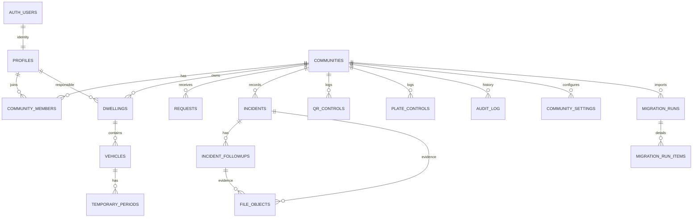

# Modelo relacional Supabase

Las migraciones `111` a `117` complementan el esquema Supabase sin modificar migraciones remotas previas. `temporary_periods` es la única fuente de verdad de matrículas temporales; la migración `113` copia valores legacy válidos, pone excepciones en cuarentena privada y elimina las tres columnas desnormalizadas de `vehicles`. La `114` endurece Storage, `116` retiene credenciales hasta validación explícita y `117` valida RLS para los 68 propietarios puros.

## Identidad y comunidad

- Las PK internas son UUID. `legacy_id` conserva trazabilidad y es único dentro de la comunidad donde corresponde.
- `profiles` extiende `auth.users`; `community_members` contiene los roles ADMIN, CONTROL y PROPIETARIO. ROOT es global.
- Las FKs compuestas `(id, community_id)` impiden relacionar viviendas, vehículos, solicitudes, incidencias, seguimientos y controles entre comunidades distintas.
- Las matrículas normalizadas son columnas generadas por `public.normalize_plate`.
- Los estados y tipos están restringidos a los valores observados y a los valores funcionales ya definidos en el código estable.

## Histórico

`audit_log` guarda simultáneamente `legacy_entity_id` y `entity_id UUID`. Los registros importados usan `source = LEGACY_SHEET`. Importarlos no dispara acciones de negocio.

Las solicitudes e incidencias mantienen campos de origen y snapshots. Una FK señala el estado actual; los snapshots explican el estado histórico.

## RLS

- PROPIETARIO ve sus viviendas, vehículos, temporales, solicitudes e incidencias asociadas.
- CONTROL ve y registra los datos operativos de su comunidad.
- ADMIN administra su comunidad y ve auditoría/importaciones.
- ROOT se valida en backend y conserva alcance global.
- La bóveda `private.legacy_auth_credentials` no tiene permisos para `anon` ni `authenticated`. Sus RPC solo conceden `EXECUTE` a `service_role`.
- `file_objects` y `storage.objects` usan bucket privado. Una fila visible por RLS debe existir antes de poder leer el objeto.

Las pruebas pgTAP de permisos están en `supabase/tests/002_migration_security.sql`; `003_rls_cross_community.sql` simula UUID manipulados entre dos comunidades. El esquema remoto pasó `supabase db lint --linked --schema public` sin errores.

## Índices principales

Se indexan email sin distinguir mayúsculas, IDs legacy, matrículas normalizadas, QR, vivienda, vehículo, incidencia, comunidad, estado y fecha. Las restricciones parciales impiden matrícula o QR duplicados por comunidad y un Slot 1/2 duplicado por vivienda.
